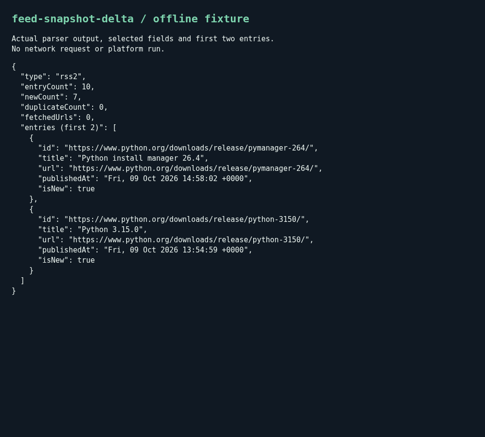

# Zendren Apify actors

[](https://github.com/XanderXML-Bit/zendren-apify-actors/actions/workflows/ci.yml)

Python actors for developers who collect public job postings, extract page-cited PDF text, or track changes in sitemaps and feeds.

## Choose an actor

All six actors have public Apify Store pages, checked on 2026-11-24.
This repository is the public source for those actors.

| Directory | Public actor | Purpose |
|---|---|---|
| `ats-job-feed/` | [ATS job feed](https://apify.com/zendren/ats-job-feed) | Combine Greenhouse, Lever, Ashby, and Workday job feeds. |
| `greenhouse-job-feed/` | [Greenhouse job feed](https://apify.com/zendren/greenhouse-job-feed) | Read public Greenhouse job boards. |
| `lever-job-feed/` | [Lever job feed](https://apify.com/zendren/lever-job-feed) | Read public Lever job postings. |
| `public-pdf-json-chunks/` | [Public PDF JSON chunks](https://apify.com/zendren/public-pdf-json-chunks) | Extract text and chunks with page references from text-based PDFs. |
| `sitemap-snapshot-audit/` | [Sitemap snapshot audit](https://apify.com/zendren/sitemap-snapshot-audit) | Compare current and previous sitemap XML documents. |
| `feed-snapshot-delta/` | [Feed snapshot delta](https://apify.com/zendren/feed-snapshot-delta) | Parse RSS or Atom feeds and identify previously unseen entries. |

Each actor's README documents its input, output, limits, and pricing.
Check its Store page before a platform run, which can incur charges.

## Inspect real output



After [local setup](#set-up-a-local-actor), run the feed parser against the committed fixture from `feed-snapshot-delta/`.

```sh
.venv/bin/python -c 'import json; from pathlib import Path; from transform import feed_document; fixture = json.loads(Path("tests/fixtures/inline_example.json").read_text()); print(json.dumps(feed_document(fixture["documents"][0]), indent=2))'
```

The command prints the full JSON, including these two fields.

```json
{
  "entryCount": 10,
  "newCount": 7
}
```

The parser uses no token, makes no network request, and incurs no platform charge.
See the [capture provenance](docs/claims.md) for details on the screenshot.

## Check the stack

The job-feed actors use Python 3.12, the Apify SDK, and HTTPX.
The document actors use Python 3.11, the Apify SDK, HTTPX, defusedxml, and pypdf.
Pytest runs the offline suites.
Pytest-asyncio runs asynchronous job-feed tests with function-scoped fixture loops.
Each directory contains a runtime pin and a hash-locked development dependency file.
The Docker builds install from separate production requirement files.

## Architecture

Each actor directory contains its own Dockerfile, Apify schemas, and dependency files.
The PDF, sitemap, and feed actors each include a copy of `fetcher.py`.
Its server-side request forgery (SSRF) guard rejects non-public addresses and checks every redirect before connecting.
Each Docker build uses its actor directory as the build context.
CI checks that all three copies match byte for byte.

## Set up a local actor

Install [uv](https://docs.astral.sh/uv/getting-started/installation/) before these steps.
The commands below create an isolated environment for one actor.

1. Clone the repository.

   ```sh
   git clone https://github.com/XanderXML-Bit/zendren-apify-actors.git
   cd zendren-apify-actors
   ```

2. Enter an actor directory.

   ```sh
   cd feed-snapshot-delta
   ```

3. Create its pinned Python environment.

   ```sh
   uv venv --python "$(cat .python-version)" .venv
   uv pip sync --require-hashes --python .venv/bin/python requirements-dev.lock
   ```

4. Run its offline tests and compile check.

   Use Linux for the full suite. The document actors' parser subprocesses set resource limits that macOS rejects.

   ```sh
   .venv/bin/python -m pytest -q -m "not live" -p no:cacheprovider
   .venv/bin/python -m compileall -q -x '/[.]venv/' .
   ```

Repeat steps two through four for each actor, starting from the repository root.
Run each suite inside its actor directory because actors use separate module names.
The `live` marker excludes tests that contact public job boards.
Some parser tests skip when an optional tool is unavailable.

## Lint the repository

From the repository root, run Ruff to check for problems such as unused imports and undefined names.

```sh
uvx --from ruff==0.17.6 ruff check .
```

## Deployment

Deployment to the Apify platform is maintained separately and is not part of this repository.
Do not run platform commands during offline setup, and keep tokens outside the repository.
The [CI workflow](.github/workflows/ci.yml) runs lint, offline tests, and dependency audits on pushes to `main` and pull requests.

## Brand

Brand: Zendren. Created by [Xander M. Lopez](https://xandermlopez.com).
The Apify username is `zendren`.

## License

Copyright (c) 2026 Xander M. Lopez. All rights reserved.
See [LICENSE](LICENSE) for the proprietary terms.
Third-party dependency and fixture licenses remain separate.
